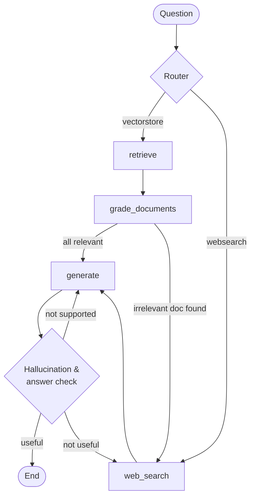
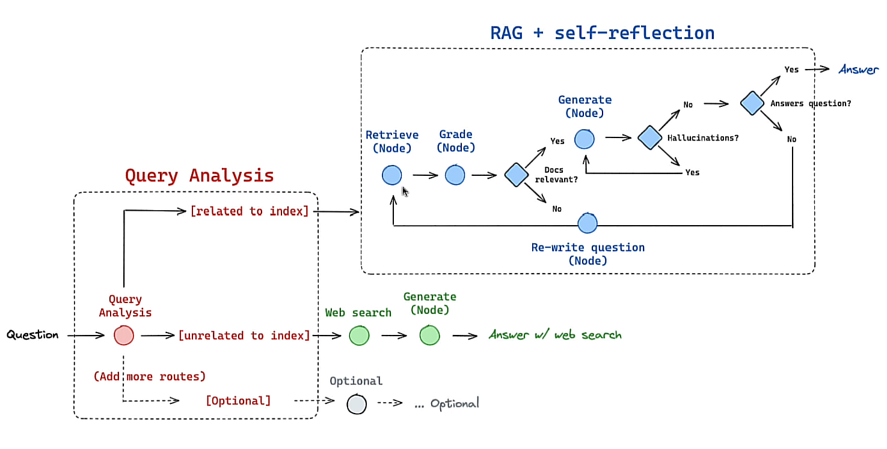

# 🧪 LLM Lab

A hands-on collection of projects I built while learning **LangChain**, **RAG**, **Agents** and **LangGraph**, step by step. Each folder covers one topic and builds on the previous one, starting from a single LLM call and ending with a self-correcting **Advanced RAG** system that grades its own answers.

All examples use **Anthropic Claude** as the LLM (via `langchain-anthropic`).

---

## 📚 Contents

| Folder | Topic | What I learned |
|---|---|---|
| [`01_langchain_giris`](01_langchain_giris) | Intro to LangChain | `ChatAnthropic`, system/human messages, `StrOutputParser`, LCEL chains (`prompt \| model \| parser`), `ChatPromptTemplate` |
| [`02_chatbot_hafiza`](02_chatbot_hafiza) | Chatbot with memory | `RunnableWithMessageHistory`, `InMemoryChatMessageHistory`, `MessagesPlaceholder`, session management |
| [`03_vector_store_rag`](03_vector_store_rag) | Vector stores & first RAG | Embeddings, Chroma, similarity search, a first retriever + prompt RAG chain |
| [`04_rag`](04_rag) | RAG over web data | `WebBaseLoader`, `RecursiveCharacterTextSplitter`, RAG prompt, streaming responses |
| [`05_agent_react`](05_agent_react) | ReAct agents | Tavily web search tool, `create_react_agent`, agent memory with `SqliteSaver` |
| [`06_langgraph_rag`](06_langgraph_rag) | Advanced RAG with LangGraph | State, nodes, conditional edges, structured output with Pydantic, retrieval / hallucination / answer graders, question routing |

---

## 🕸️ 06 – Advanced RAG with LangGraph

This project tackles three common weaknesses of a basic RAG pipeline:

1. **Irrelevant documents**: a *Retrieval Grader* scores every retrieved document, drops the irrelevant ones and falls back to web search when needed.
2. **Hallucinations**: a *Hallucination Grader* checks whether the answer is actually grounded in the documents and regenerates it if it is not.
3. **Answers that miss the question**: an *Answer Grader* checks whether the answer resolves the question and triggers a web search if it does not.

On top of that, a **Router** decides up front whether a question should go to the vector store or straight to web search.





### Project structure

```
06_langgraph_rag/
├── ingestion.py              # Loads web pages, splits them, stores them in Chroma → retriever
├── main.py                   # Runs the graph
└── graph/
    ├── graph.py              # StateGraph: nodes, edges, conditional routing
    ├── state.py              # GraphState (question, generation, web_search, documents)
    ├── node_constants.py     # Node names
    ├── chains/
    │   ├── router.py                 # Routes the question to vectorstore / websearch
    │   ├── retrieval_grader.py       # Is the document relevant to the question?
    │   ├── generation.py             # Generates the RAG answer
    │   ├── hallucination_grader.py   # Is the answer grounded in the documents?
    │   └── answer_grader.py          # Does the answer resolve the question?
    └── nodes/
        ├── retrieve.py
        ├── grade_documents.py
        ├── generate.py
        └── web_search.py
```

The knowledge base consists of Lilian Weng's blog posts on *LLM Powered Autonomous Agents*, *Prompt Engineering* and *Adversarial Attacks on LLMs*. Embeddings are generated locally with `sentence-transformers/all-MiniLM-L6-v2`, so no extra API key is needed for them.

### Example run

```
ROUTE QUESTION
----RETRIEVE-----
---CHECK DOCUMENT RELEVANT TO QUESTION
-----GRADE: DOCUMENT RELEVANT
-----GRADE: DOCUMENT RELEVANT
-----GRADE: DOCUMENT RELEVANT
-----GRADE: DOCUMENT RELEVANT
---ASSESS GRADED DOCUMENTS----
----GENERATE------
CHECK HALLUCINATION
GENERATION IS GROUNDED IN DOCUMENTS
GENERATION ADDRESSES QUESTION

===== CEVAP =====
Agent memory is a key component of LLM-powered autonomous agents that consists of two types:
short-term and long-term memory. Short-term memory utilizes in-context learning, ...
```

---

## ⚙️ Setup

> Tested with Python **3.11**.

```bash
git clone https://github.com/MuhammetDikmetas/llm-lab.git
cd llm-lab

python -m venv .venv
# Windows (PowerShell)
.\.venv\Scripts\Activate.ps1
# macOS / Linux
source .venv/bin/activate

pip install -r requirements.txt
```

Copy `.env.example` to `.env` and add your own keys:

```bash
cp .env.example .env
```

| Variable | Where to get it | Needed for |
|---|---|---|
| `ANTHROPIC_API_KEY` | [console.anthropic.com](https://console.anthropic.com) | All folders |
| `TAVILY_API_KEY` | [tavily.com](https://tavily.com) | `05`, `06` |
| `LANGCHAIN_API_KEY` | [smith.langchain.com](https://smith.langchain.com) | Optional (LangSmith tracing) |

---

## ▶️ Usage

Scripts in folders `01`–`05` run on their own:

```bash
python 01_langchain_giris/04_prompt_template.py
python 05_agent_react/02_hafizali_web_arama_agenti.py
```

Project `06` must be run from inside its own folder so that the `graph` package can be imported:

```bash
cd 06_langgraph_rag
python ingestion.py      # First run: builds the vector store (.chroma)
python main.py           # Runs the graph
python -m graph.graph    # (Optional) Saves the graph visualization as graph.png
```

Change the question in `main.py` to try both paths:
- `"What is agent memory?"` → vector store path
- `"How can I make hamburgers?"` → web search path

---

## 🛠️ Tech Stack

LangChain · LangGraph · Anthropic Claude · Chroma · Sentence-Transformers · Tavily · LangSmith · Pydantic

---

## 👤 Author

**Muhammet Dikmetaş** – [GitHub](https://github.com/MuhammetDikmetas)
